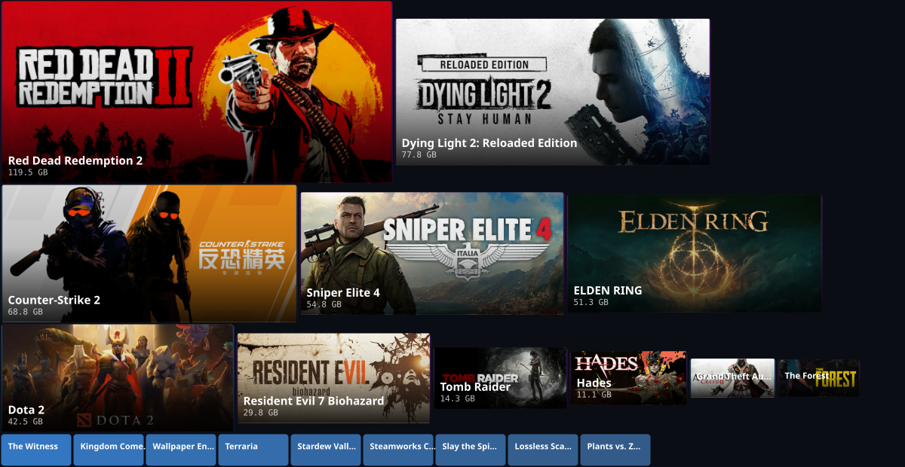

# Steam Storage Explorer

看一眼就知道哪个游戏在吃硬盘 —— 以及你为它付出了多少时间。



Steam 自带的存储管理只告诉你每个游戏占多大。这个工具把占用摊成一面卡片墙，
再把**累计游玩时长**叠上去：卡片大、时长也大的，是真好玩；占了半个盘、
时长只有两位数的，该考虑清掉了。

每张卡片铺的是游戏自己的封面 —— 优先用 Steam 客户端已经缓存好的图，本地没有的才回退到
Steam 官方静态 CDN（公开资源，无需 key）。

## 它能做什么

- **卡片墙**：卡片面积对应磁盘占用，一眼看出谁是大头
- **铺游戏封面**：卡片长宽比锁死成封面的比例（460×215），封面正好铺满，
  不裁切、不拉伸；图太小看不清的卡片自动退回纯色
- **排法**：卡片按行往下流，行尾自然空着，画布高度跟着内容走 —— 不硬塞进一块固定大小的矩形里，
  所以不会出现拼图式的空洞
- **按存储 / 按时长一键切换**：同一个页面，换一种看法 —— 谁占硬盘，谁占人生
- **每个游戏的数据**：占用大小、累计时长、最近启动、每小时占用成本
- **多库合并**：Steam 装在几个盘上也能一起统计
- 搜索、按库筛选、按任意列排序

## 快速开始

先确认电脑上有没有 Python（`python --version` 或 `python3 --version`）。
有就用第二种方式，没有就用第一种 —— 两种都能出完整结果。

### 方式一：不需要 Python

下载 [`dist/steam-storage.html`](dist/steam-storage.html) 双击打开即可，也可以直接访问
[在线版](https://liz854.github.io/steam-storage/)。
两种拿到的东西功能完全一样，前者能离线用、能拷给别人。

浏览器出于安全考虑不允许网页自己扫描磁盘，所以需要手动指一次目录：

1. 点「选择 Steam 文件夹」
2. 选 Steam 根目录（如 `D:\Steam`）或任意一个 SteamLibrary 目录
3. 出图

不想点选也可以把文件夹**直接拖进页面**。拖拽会跳过游戏安装目录，比用选择器更快。

看完点「导出报告」，会下载一个自带数据的 HTML 文件 —— 发给别人双击就能看，
对方同样什么都不用装。这是这个工具在没有 Python 的机器上最完整的用法。

> 浏览器拿不到真实盘符，库名只显示文件夹名。

### 方式二：本地服务（推荐，需要 Python）

```bash
python scan.py --serve
```

浏览器会自动打开 `http://127.0.0.1:8765`，页面自动检测 Steam 目录并出图。
检测不到时会给出路径输入框和磁盘浏览，手动指一个就行。

这个模式下网页只是界面，读磁盘的工作由本机进程完成 —— **所以能做到自动检测**。
服务只监听 `127.0.0.1`，数据不出本机。

### 方式三：命令行生成报告（需要 Python）

```bash
python scan.py
```

生成 `steam_storage_report.html`，样式、脚本、数据全部内联在一个文件里。
可以直接发给别人，对方双击就能看。

```
Steam 目录: D:\Steam   （来源: 注册表）
发现 2 个游戏库

  D:\Steam                           12 个游戏    127.0 GB
  E:\SteamLibrary                     8 个游戏    364.1 GB

共 20 个游戏，合计 491.1 GB，累计游玩 849 小时
占用 Top 5:
    119.5 GB       60 小时  Red Dead Redemption 2
     77.8 GB      4.0 小时  Dying Light 2: Reloaded Edition
     68.8 GB      494 小时  Counter-Strike 2
     54.8 GB      3.0 小时  Sniper Elite 4
     51.3 GB       70 小时  ELDEN RING
```

不需要 `pip install` 任何东西，Python 3.8+ 标准库即可。

### 连选目录都省掉：打包成可执行文件

单文件版仍需手选一次目录，这是浏览器安全模型的底线。如果连这一步都不想省，
可以把扫描器打成原生可执行文件：

```bash
pip install pyinstaller
pyinstaller -F -n steam-storage scan.py
```

产物在 `dist/steam-storage.exe`（Windows）。双击运行会直接扫盘、出报告、打开浏览器。
PyInstaller 不支持交叉编译，要发给 Windows 用户就在 Windows 上打，macOS / Linux 同理。

体积从 66 KB 涨到 10 MB 左右，换取的是「打开就自动出结果」。

## 数据从哪来

全部来自 Steam 自己写的本地文件，只读，不启动 Steam，不需要 API key。
唯一可能联网的地方是封面兜底：本地缓存没有时才去官方 CDN 取，加 `--no-cdn` 可以关掉。

| 数据 | 文件 | 字段 |
|---|---|---|
| 游戏名、占用大小 | `<库>/steamapps/appmanifest_<appid>.acf` | `name`、`SizeOnDisk` |
| 最近启动时间 | 同上 | `LastPlayed` |
| **累计游玩时长** | `<Steam>/userdata/<账号>/config/localconfig.vdf` | `Playtime`（分钟） |
| 所有游戏库的位置 | `<库>/steamapps/libraryfolders.vdf` | `path` |
| **游戏封面** | `<Steam>/appcache/librarycache/<appid>/header.jpg` | 图片文件本身 |

封面就是 Steam 客户端界面上显示的那张图，优先从本地缓存读，不联网。
只认横版 `header`：竖版 `library_600x900`（300×450）塞进横着的卡片里等比缩放后
左右会空一大片，看着像贴错图，这种游戏改从 CDN 取横版；
`library_hero` 是 1920×620 的横幅，塞进卡片里只会糊成一片，明确排除。

客户端还没缓存过的游戏（刚装上、没在库里点开过），回退到 `cdn.cloudflare.steamstatic.com`
上的同名资源 —— 这是 Steam 自己的公开静态图床，不需要 API key，任何用户都能用。
连不上网时卡片自动露出底色，不影响其他信息，也不会报错、不会卡住。

> 想让整个过程完全不联网：加 `--no-cdn`（命令行）或者 `window.__STEAM_CDN_COVER = false`（网页版控制台）。

`SizeOnDisk` 就是 Steam 客户端「属性 → 已安装文件」显示的那个数字，所以统计结果和客户端完全一致，
不需要遍历整个文件系统去累加（那样既慢又容易把创意工坊和着色器缓存算错）。

机器上有多个 Steam 账号时，同一游戏的时长取所有账号里的最大值。

**唯一的口径差异**：`SizeOnDisk` 不含创意工坊内容（workshop）和着色器缓存（shadercache），
所以磁盘实际占用会比这里显示的高一点。

## Steam 目录是怎么找到的

命令行和本地服务模式会按可靠性依次尝试，第一个命中就用：

1. **环境变量** `STEAM_PATH` / `STEAM_ROOT`
2. **Windows 注册表** —— `HKCU\Software\Valve\Steam` 的 `SteamPath`，失败再试 `HKLM` 下的 `InstallPath`。
   直接调 `winreg` API，即使系统禁用了 `reg.exe` 也不受影响
3. **常见安装路径** —— Windows 的 `C:\Program Files (x86)\Steam`、`D:\Steam` 等，
   以及 macOS / Linux / Flatpak / Steam Deck 的默认位置
4. **扫盘兜底** —— 每个盘符根目录下名字含 `steam` 的文件夹，外加 `Games`、`Program Files` 往下一层

多个候选时优先选**主库**（`steamapps` 下有 `libraryfolders.vdf` 的那个），其次选路径最短的。

定位到主库后，其余库从 `libraryfolders.vdf` 一次性读出，不用逐个指定。
自动检测全失败时用 `--steam` 手动指定；路径可以在 Steam 客户端「设置 → 存储 → 库右侧齿轮 → 本地文件」里看到。

## 命令行参数

| 参数 | 说明 |
|---|---|
| `--steam PATH` | 手动指定 Steam 根目录 |
| `-o, --output FILE` | 报告输出路径，默认 `steam_storage_report.html` |
| `--json FILE` | 额外导出原始 JSON |
| `--open` | 生成报告后自动打开浏览器 |
| `--no-covers` | 报告里完全不放封面，体积从约 1.3 MB 降到 66 KB 左右 |
| `--no-cdn` | 本地缓存没有封面时不去官方 CDN 取，只显示底色 |
| `--serve` | 启动本地服务（默认 `127.0.0.1:8765`） |
| `--port N` | 配合 `--serve` 指定端口，被占用会自动往后找 |
| `--no-browser` | 配合 `--serve` 不自动弹浏览器 |

## 数据格式

`--json` 导出的结构，也是网页内部使用的格式：

```jsonc
{
  "generatedAt": "2026-01-01 00:00:00",
  "version": "1.1.0",
  "steamRoot": "D:\\Steam",
  "libraries": [
    { "path": "D:\\Steam", "total": 1000007168000, "free": 350000000000,
      "gameCount": 12, "gameBytes": 136354474227 }
  ],
  "games": [
    { "appid": 1174180, "name": "Red Dead Redemption 2", "size": 128312147968,
      "playtime": 3600, "lastPlayed": 1792041805, "lastUpdated": 1792301005,
      "installdir": "Red Dead Redemption 2", "lib": "E:\\SteamLibrary" }
  ],
  "totals": {
    "bytes": 527303872344, "playtimeMinutes": 50937,
    "count": 20, "libraryCount": 2
  }
}
```

`size` 单位字节，`playtime` 单位分钟，时间为 Unix 时间戳。

`cover` 字段不在 `--json` 里（避免导出的数据文件被图片撑大），只会是三种形态：

| 形态 | 出现场景 |
|---|---|
| `data:image/jpeg;base64,...` | 报告里内联，离线双击就能看 |
| `/api/cover/<appid>` | 本地服务按需回图，不占 JSON 体积 |
| `https://cdn.cloudflare.steamstatic.com/...` | 本地缓存没有，回退到官方 CDN |

前端渲染时对三种形态一视同仁，直接塞进 `background-image`。
底色始终保留在 `background-color` 里，图加载失败会自然露出来，所以不需要 `onerror` 兜底。

## 已知限制

- 不含创意工坊和着色器缓存，比文件资源管理器看到的少一点
- 网页版无法自动检测目录（浏览器安全限制），只能手动选择
- 网页版拿不到真实盘符，库名只显示文件夹名
- 网页版用「选择文件夹」时会遍历整个目录，Steam 库特别大时要等一会儿；
  改用拖拽可以跳过游戏安装目录，快很多
- 想看到游玩时长，需要选中包含 `userdata` 目录的 Steam 根目录；只选附加库则没有时长
- 网页版选 `steamapps` 或附加库时读不到 `appcache`（它在 Steam 根目录下），这些游戏会走 CDN；
  想全部用本地缓存，选 Steam 根目录
- 内联封面的报告约 1.3 MB（34 个游戏），嫌大就加 `--no-covers`
- 只对足够大的卡片铺封面（宽 ≥ 68、高 ≥ 44 像素），太小的卡片贴图只会糊成一团
- 卡片的长宽比是固定的 460×215，不是正方形也不是随意的 —— 只有和封面同比例，封面才能不裁切地铺满
- 卡片宽 ∝ √占用，所以面积仍然正比于占用；但宽度有下限（96px），
  极小的游戏（几十 MB）会被放大到能看清名字，这部分的面积只能是近似
- 官方 CDN 只提供横版 `header.jpg`，极少数游戏没有这张图，那些卡片就是纯色
- 只统计已安装的游戏，未安装/隐藏的不在清单里
- 时长来自本地缓存文件，与 Steam 服务器数据可能存在少量偏差

## 项目结构

```
scan.py                     扫描器 + 本地服务 + 报告生成
dist/
  steam-storage.html        单文件版（构建产物），双击即用，不需要 Python
web/
  index.html                网页入口（GitHub Pages 用这个）
  app.js                    渲染逻辑 + 浏览器端 .acf/.vdf 解析 + 导出
  style.css                 样式
templates/
  report.html               报告骨架，scan.py 把 css/js/数据内联进去
docs/
  preview.svg               README 顶部那张图，由 make_preview.py 生成
tools/
  build_single.py           把 web/ 三件套压成 dist/steam-storage.html
  make_preview.py           从 JSON 生成 README 用的 SVG 预览图
test/
  check_layout.js           布局几何校验：不越界 / 不重叠 / 比例=封面比例
  check_render.js           用 DOM stub 实跑渲染，含存储/时长双视图
  check_picker.js           零依赖路径校验：浏览器端解析 .acf / .vdf
  test_scan.py              扫描器单元测试
  test_build.py             单文件产物的自包含性检查
  fixture.json              测试与预览图共用的合成数据
.github/workflows/
  test.yml                  两个 Python 版本跑单元测试 + JS 校验
  pages.yml                 把 web/ 部署成 GitHub Pages
```

渲染逻辑只有 `web/app.js` 一份。报告版由 `scan.py` 在构建时把它内联进 HTML，
单文件版由 `tools/build_single.py` 做同样的事，所以不会出现几份逻辑不一致的问题。

`dist/steam-storage.html` 是提交进仓库的构建产物 —— 改了 `web/` 之后记得重新生成，
CI 会比对，不同步会失败。

## 开发

```bash
# 重新生成单文件版（改过 web/ 后必须跑）
python tools/build_single.py

# 生成报告 + 导出数据
python scan.py --json data.json --open

# 本地服务（改前端时不用反复重建报告）
python scan.py --serve

# 预览图（默认读 test/fixture.json 的合成数据，不会把你自己的游戏库画进去）
python tools/make_preview.py
python tools/make_preview.py --data data.json   # 想看自己库的实际效果

# 测试
python -m unittest discover -s test -p "test_*.py"
node test/check_layout.js
node test/check_render.js
node test/check_picker.js
```

`test/check_layout.js` 会拿合成数据在多种画布尺寸下验证布局算法：卡片数对得上、
没有越界、互不重叠、每张卡片的长宽比都严格等于封面比例、占用大的卡片不会比占用小的还小。
改动布局相关代码后先跑它。

## 部署到 GitHub Pages

仓库已带 `.github/workflows/pages.yml`。推上去之后在 **Settings → Pages** 把 Source 选成
**GitHub Actions**，之后每次改动 `web/` 都会自动部署，访问地址形如
`https://liz854.github.io/steam-storage/`。

`.gitignore` 排除了 `data.json` 和生成的报告 —— 那里面是本机的游戏列表，不该进公开仓库。

## License

MIT
